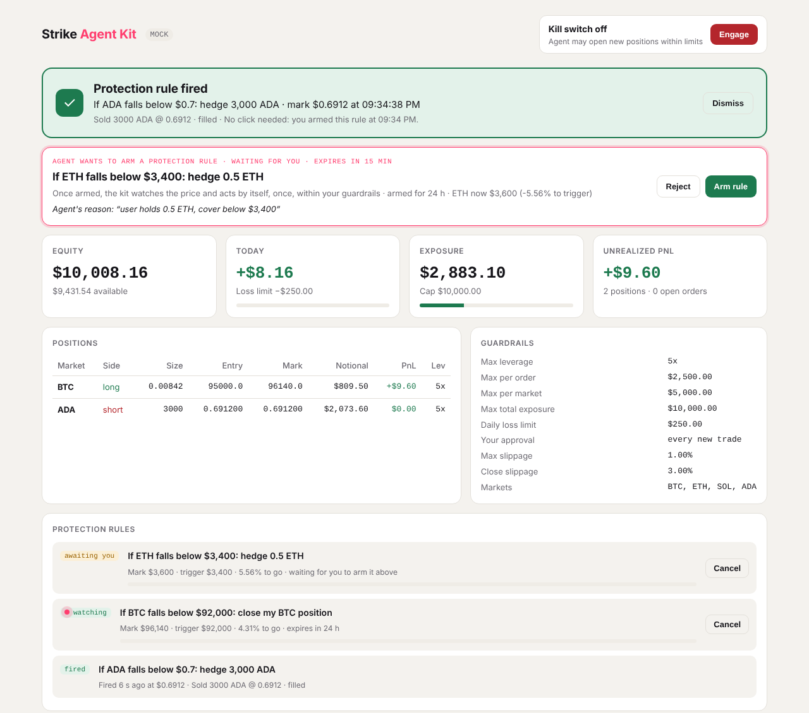

# Strike Agent Kit

**Let AI agents trade on Strike, inside limits they can't talk their way past.**

Strike Agent Kit is an MCP server that lets Claude, Cursor, or any MCP-compatible agent read Strike markets, compare funding against Hyperliquid, hedge spot holdings and place orders on Strike perpetuals. Every order passes through a guardrail engine that the human controls.

Built for the Strike Hackathon (21–23 October 2026).



## In plain words

You trade on Strike by talking to an AI assistant instead of clicking through a trading screen. Say what you want, for example *"protect my ADA if the price drops"*. The assistant works out the trade, and it only goes to Strike after you click **Approve** in your own dashboard.

Giving an AI your trading account is normally scary. Here the AI gets **a key with a leash**:

- **It can trade, but it can never withdraw.** Strike's API wallets don't allow withdrawals, so your money can't leave the account.
- **You set the rules.** For example: at most $2,500 per trade, at most 5x leverage, stop after a $250 loss today. The AI can't change these rules or work around them.
- **Nothing new happens without your click.** Every trade that adds risk waits in your dashboard until you approve it. The AI cannot approve on your behalf. So a casual "BTC looks strong" in a chat can never quietly turn into a trade, and neither can instructions hidden in a web page the AI read.
- **There's an emergency brake.** The AI can pull it when something looks off. Only you can release it, from your dashboard. While it's on, no new bets are possible, but closing positions always works.
- **It can stand guard while you're away.** Tell it *"if ADA drops below $0.20, hedge my 5,000 ADA"*. You approve that rule once; from then on the kit watches the price and places the hedge by itself the moment ADA crosses the line, still inside your limits. You get a notification and a big "rule fired" banner in the dashboard.
- **Everything is written down.** Every trade it proposed, placed or was refused is logged together with the AI's reason.

Things you can ask:

- *"Where can I earn the most from funding right now?"*
- *"I hold 3,000 ADA, protect me if it falls."*
- *"If ADA drops below $0.20, hedge my 5,000 ADA."*
- *"If SOL falls under $90, close my SOL long."*
- *"How am I doing today?"*
- *"Close everything."*
- *"Stop, no new trades."*

### How to use it

1. **Create a Strike account and add funds.** Connect a wallet in the Strike app and deposit.
2. **Create an API wallet.** This is the AI's key on a leash. You'll find it on the API Wallets page in the Strike app.
3. **Set your limits** in `guardrails.json`.
4. **Add the kit to Claude Desktop**, or any app that supports MCP, the plug-in standard for AI tools.
5. **Open the dashboard** at `http://127.0.0.1:8787` next to the chat, start asking, and approve the trades you want.

The plan after the hackathon is to collapse steps 2 and 3 into a single "Connect with Strike" button through Builder Connect, with a settings page for the limits.

## Why

Agents are about to become a large share of on-chain trading flow, but nobody should hand an LLM an unrestricted trading key. This kit gives an agent exactly three things:

1. **Strike data.** Markets, the account, positions, and a live funding comparison with Hyperliquid.
2. **Strike execution.** Market and limit orders, closing positions, and one-call hedging of spot exposure.
3. **Hard limits and a human in the loop.** A policy file the agent cannot edit, and an approval queue only you can clear. If it hits a limit, it has to stop and tell you.

It uses Strike's API wallets, which can trade but cannot withdraw. Even a misbehaving agent cannot move funds off the account.

## What the agent can do

| Tool | What it does |
|---|---|
| `get_funding_board` | Strike vs Hyperliquid hourly funding per market, ranked by spread. Shows the delta-neutral direction, the APR, and how many hours the spread must last to cover taker fees on both venues. |
| `get_account` | Equity, available balance, positions, today's PnL against the daily loss limit, and the kill switch state |
| `get_markets` | Mark price, funding, max leverage and size rules per market |
| `what_if` | "What happens if ADA drops 20%?" Re-prices your positions, spot holdings outside Strike and (optionally) ADA-denominated margin. Shows PnL, equity, the maintenance-margin buffer, whether the daily loss limit would trip, and how well your spot is hedged. Read-only. |
| `request_hedge` | "I hold 3,000 ADA, keep me hedged." Prepares moving the perp position to −spot × ratio (only the difference is traded). Preview first; then it becomes a card in your dashboard that you execute. |
| `request_order` | Market and limit orders. Preview by default (`dry_run=true`); with `dry_run=false` it becomes a card in your dashboard. **The agent never executes a trade:** Strike only gets the order when you click Approve. |
| `get_order_status` | Outcome of a request that was waiting for you: pending, executed, rejected, expired, or blocked on approval (orders); pending, applied, rejected or expired (guardrail changes) |
| `request_close` | Prepares a reduce-only close, which you execute in the dashboard. Never blocked by limits or the kill switch. On execution, if the book is too thin for 0.5% slippage it retries once at `close_max_slippage`, then tells you plainly instead of looping. |
| `cancel_open_orders` | Cancels open orders on all markets or on one market |
| `propose_guardrail_change` | Change a limit. **Tightening applies at once; loosening waits for your click in the dashboard.** "Lower my daily loss limit to $100" takes effect now; "raise it to $500" becomes an approval card. |
| `propose_protection_rule` | "If ADA drops below $0.20, hedge my 5,000 ADA" or "if SOL falls under $90, close my long". The agent proposes; **you arm it once** in the dashboard; the kit then watches the mark price and fires the action by itself, at most once, through the normal guardrails. |
| `list_protection_rules`, `cancel_protection_rule` | The rules with live distance to the trigger, and whether they fired and what happened. The agent can disarm a rule, never arm one. |
| `engage_kill_switch` | Blocks all new risk immediately. The agent can turn it on but not off. |
| `get_guardrails`, `get_action_log` | The policy, and an audit log of every preview, block and order together with the agent's stated reason |

## Guardrails

`guardrails.json` is re-read on every order, so edits take effect immediately. You can edit it by hand, or let the agent change it with `propose_guardrail_change` (see the design rules).

```json
{
  "kill_switch": false,
  "allowed_markets": ["BTC-USD", "ETH-USD", "SOL-USD", "ADA-USD"],
  "allowed_order_types": ["market", "limit"],
  "max_leverage": 5,
  "max_order_notional_usd": 2500,
  "max_position_notional_usd": 5000,
  "max_total_notional_usd": 10000,
  "daily_loss_limit_usd": 250,
  "max_slippage": 0.01,
  "close_max_slippage": 0.03,
  "confirm_above_usd": 1000,
  "require_human_approval": true,
  "auto_approve_below_usd": 0
}
```

Design rules:

- **The agent prepares, you execute.** The agent-facing order tools (`request_order`, `request_hedge`, `request_close`) never send anything to Strike. They preview, or they put a request in your dashboard; only your click there executes it. This holds whatever the policy file says, so `auto_approve_below_usd` and the confirmation-token fallback below only apply to code that calls the service directly, never to an agent. The one thing that trades without a fresh click is a protection rule you armed yourself.
- **Reducing risk is always allowed.** With the kill switch on, or after the daily loss limit is hit, a close is never blocked. You can never be locked into a losing position.
- **Leverage is capped automatically.** New risk never opens at the account's default leverage if that is above the policy. The kit lowers it first and says so.
- **The human approves new risk, outside the chat.** With `require_human_approval` on (the default), every order that opens or adds risk is parked as *pending* and appears as a card in the dashboard. Only a click there sends it to Strike. No MCP tool can approve. This is what stops a misread chat or a prompt injection from becoming a trade.
  - On approval the whole pipeline runs again. If the kill switch was pulled or a limit is now hit, the order is blocked even though you approved it.
  - Requests expire after 15 minutes.
  - Closes wait for your click too, but are never blocked.
- **For scripts that call the service directly** (not the agent): `auto_approve_below_usd` lets small orders through without a click, and with approval mode off, orders above `confirm_above_usd` need a single-use, order-bound confirmation token that expires after 5 minutes.
- **The agent can tighten limits, never loosen them.** `propose_guardrail_change` applies a stricter value at once (lower caps or leverage, a lower loss limit, fewer markets, approval switched on). Anything looser becomes an approval card in the dashboard, like an order. A proposal that mixes both applies the tighter part and queues the rest.
  - Switching the daily loss limit off (`0`) or allowing every market (`[]`) counts as loosening.
  - Changes to `close_max_slippage` and `allowed_order_types` always wait for you, in either direction, because a "stricter" value there could stop you from closing a position in a thin market.
  - The kill switch is not part of it: the agent can only engage it, and only you can release it.
  - The server instructions tell the agent to propose loosening only when you ask for it, never as a way around a blocked order.
- **Protection rules are pre-approved, not unguarded.** The agent can only *propose* a rule ("if ADA trades below $0.20, hedge 5,000 ADA"). It becomes active only when you click **Arm rule** in the dashboard. A watcher thread then checks the mark price every few seconds (`STRIKE_WATCH_INTERVAL_S`, default 5) and, when the condition is met, places the order without asking again: that click was your approval.
  - The order still runs through every guardrail at the moment it fires. If the kill switch is on or a limit is hit, the rule fires, is **blocked**, and tells you so. It never retries.
  - A rule fires at most once, expires after 24 hours by default (max 7 days), and you or the agent can cancel it at any time. At most 5 rules are active at once.
  - When you are asked to arm it, the card shows what the hedge would be at today's price, and warns you if your guardrails would block it.
  - On a Mac, a firing rule also posts a desktop notification (turn off with `STRIKE_NOTIFY=0`).
  - The daily loss limit counts too: in a sharp drop, losses elsewhere can trip it and block the hedge. Keep the limit realistic, or set the trigger earlier.
- **No workarounds.** The server instructions tell the agent never to split or resize an order to get past a limit. Per-position and total-exposure caps also make splitting pointless.
- **Everything is logged** to `.strike-agent/journal.jsonl`.

## Dashboard: the human's side

The dashboard runs inside the MCP server process and is served on `http://127.0.0.1:8787`. It is bound to localhost only, and you can disable it with `STRIKE_DASHBOARD_PORT=0`. It shows:

- equity, today's PnL against the loss limit, and exposure against the cap
- positions and the active guardrails
- the funding board
- a live feed of everything the agent did, with its stated reasons
- **protection rules**: armed rules with a pulsing *watching* badge, the live mark, the distance to the trigger and a Cancel button. When a rule fires, a banner at the top says what it did, at what price, and that no click was needed.
- **approval cards** for orders, looser limits and protection rules waiting for you, with Approve and Reject buttons, the agent's reason, and a countdown to expiry. The browser tab title shows the number of waiting requests.

It is the only place orders, looser limits and protection rules can be **approved** and the only place the kill switch can be **released**. There are no MCP tools for either. Requests without the dashboard's custom header are refused, so other websites open in your browser can't flip the switch.

Run `python scripts/dashboard_preview.py` to see it on a mock account with sample activity.

## How each order flows

```
agent request
  → normalize symbol, convert notional to size
  → round to Strike's tick and step grid, check min size and min notional
  → guardrails: kill switch, markets, leverage, order, position and total caps, daily loss, slippage
  → preview / blocked / pending_approval   (nothing sent)
  → human clicks Approve in the dashboard  → full guardrail check again
  → set leverage → POST /v2/order (Ed25519-signed, optional X-Builder-Fee-Bps)
  → poll GET /v2/order until filled or rejected (Strike's order writes are async)
  → audit log
```

## Quick start (mock mode, no keys)

```bash
pip install -e .
python -m pytest            # 88 tests
python scripts/demo_walkthrough.py   # runs the full demo over a real MCP connection
```

Mock mode simulates Strike and Hyperliquid with made-up prices, so you can try everything without risking funds.

## Use with Claude Desktop

Run `python scripts/claude_desktop_config.py`. It prints the config entry with this machine's paths filled in. Paste it into `claude_desktop_config.json` (Claude Desktop → Settings → Developer → Edit Config) and restart Claude Desktop. The entry looks like this:

```json
{
  "mcpServers": {
    "strike": {
      "command": "python",
      "args": ["-m", "strike_agent_kit.server"],
      "cwd": "/path/to/strike-agent-kit",
      "env": { "STRIKE_MODE": "mock" }
    }
  }
}
```

Then ask something like: *"Which Strike market has the best funding edge vs Hyperliquid right now? I hold 0.05 ETH, hedge it on Strike."*

## Testnet and mainnet

The kit runs on both. Testnet is the safe default for building and demos; mainnet is locked behind an explicit opt-in.

1. Create an account on Strike testnet and fund it. Testnet deposits are in ADA and need a connected Cardano wallet; an email login can't deposit there. Test ADA comes from the Cardano testnet faucet.
2. Create an API wallet on the API Wallets page. Alternatively, run `python -m strike_agent_kit.signing` to generate a key pair locally and register the public key there.
3. Copy `.env.example` to `.env`, then set `STRIKE_MODE=testnet` and both keys.
4. Run `python scripts/testnet_check.py`. It checks the clock sync, signing and account reads, and places no orders.
5. Run `STRIKE_MODE=testnet python scripts/demo_walkthrough.py`, or connect Claude Desktop.

On testnet, use BTC or ETH for market orders. The ADA and SOL testnet order books can sit far from the mark price (about 20% on 22 October 2026), so market orders there get cancelled for slippage. The kit warns about this in every order preview.

Mainnet is locked unless you also set `STRIKE_ALLOW_MAINNET=1`. For a small mainnet run, point `STRIKE_GUARDRAILS` at `guardrails.mainnet.json`, which allows 3x leverage, $150 per order and a $15 daily loss limit.

## Builder codes

The kit is self-hosted: every user runs it locally with their own API wallet, and no third party holds keys or places trades for them.

It is also ready for distribution through Strike's Builder Connect. A wallet, exchange front-end or agent platform that ships the kit can set `STRIKE_BUILDER_FEE_BPS`, and every order then carries `X-Builder-Fee-Bps`. Agent-placed trades earn builder revenue for whoever distributes the kit, which rewards shipping agents with tight guardrails.

## Project layout

```
strike_agent_kit/
  signing.py      Ed25519 request signing (METHOD:PATH:TS:NONCE:SHA256(body))
  client.py       Strike v2 REST client (clock sync, signed requests, builder fee header)
  hyperliquid.py  Public funding feed (metaAndAssetCtxs)
  guardrails.py   Policy + pure evaluation function
  service.py      Order pipeline, funding board, hedging, kill switch
  journal.py      Audit log, day-start equity, confirmation tokens
  mock.py         In-memory Strike + Hyperliquid for tests and demos
  server.py       MCP server (16 tools, plus simulate_price_move in mock mode)
  dashboard.py    Local control panel (stdlib HTTP, single page)
  watcher.py      Background thread that fires armed protection rules; macOS notifications
scripts/
  demo_walkthrough.py   Demo rehearsal over MCP stdio
  testnet_check.py      Read-only connectivity check with real keys
  dashboard_preview.py  Dashboard on a mock account with sample activity
tests/                  Signing, client (signature-verifying fake server), guardrails, service, protection rules, dashboard
```

## Roadmap

- **Builder Connect web flow.** A small Next.js page where users connect a wallet, approve the builder fee, and get an agent key scoped to a sub-account with its own guardrails.
- **Telegram approvals.** The same approval cards delivered as Telegram buttons, so you can approve from your phone while an agent runs unattended.
- **Funding-arb execution.** Paired Strike + Hyperliquid legs with leg-risk handling. The board already identifies the trades.
- **x402 / agent-to-agent.** Paid signal and hedging endpoints that other agents call.
- **User-stream listener.** Real-time fills and rejects over `wss://…/ws/user-api` instead of polling.

## Limits

- Daily PnL is the change in equity since the first reading of the UTC day, minus deposits and withdrawals. A wallet change while positions stay the same is treated as a deposit or withdrawal, so funding paid in that window is left out too.
- If your margin is held in ADA (or another volatile asset), set `STRIKE_COLLATERAL_ASSET=ADA`. Price moves on the collateral then count toward daily PnL and the loss limit, and only changes in the amount held count as deposits or withdrawals. The kit assumes the whole wallet is held in that asset.
- Protection rules trigger on Strike's mark price, checked every few seconds while the MCP server (Claude Desktop) is running. If the server isn't running, nothing is watched. A rule fires a market order, so in a fast or thin market the fill can be worse than the trigger price.
- Mock prices are illustrative, not live.
